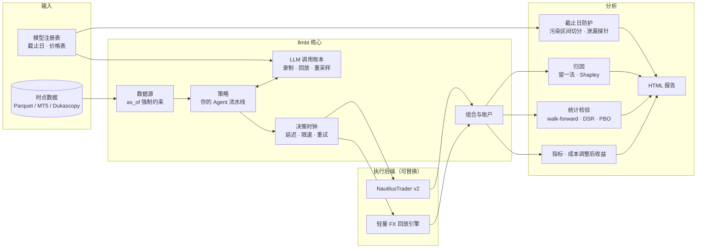

# llm-backtest-framework 路线图（2026 版）

> **English summary.** `llmbt` aims to be the backtester that keeps LLM trading strategies honest. Execution engines are pluggable (a lightweight FX-aware replay engine first, NautilusTrader as an optional high-fidelity backend). The value is in the LLM layer: a content-addressed call ledger (record / exact replay / resample), knowledge-cutoff guards with leakage probes, a decision clock (latency, rate limits, retries), LLM cost as a P&L line, distributions over repeated runs, and per-agent attribution from OpenTelemetry traces. Target: `v0.1` on PyPI around New Year 2027, `v0.3` by late January 2027, `v1.0` by spring 2027.
>
> 本文是 2026 年三仓库大升级的一部分，总计划见 [multi-agent-quant · docs/roadmap](https://github.com/Caesarcph/multi-agent-quant/blob/master/docs/roadmap/README.md)。编写日期：2026-11-03。

---

## 一、重新定位

LLM 交易策略的回测，通常会在五个地方"说假话"：

| # | 假话 | 实际情况 |
|---|---|---|
| 1 | **前视偏差** | 模型训练时可能已经"见过"回测区间的行情和新闻。研究发现，测试区间一旦挪到知识截止日之后，Agent 的夏普普遍会掉一半以上 |
| 2 | **成本为零** | 一个回测里赚钱的策略，扣掉 API 费用可能就亏了 |
| 3 | **决策瞬间完成** | 一次调用要几秒到几十秒，再加上限速排队，实际成交价早就变了 |
| 4 | **结果是确定的** | 同样的输入，模型每次的回答可能都不一样，只跑一次等于只看了一条随机路径 |
| 5 | **说不清功劳是谁的** | 多 Agent 系统里，到底是哪个分析师、哪个工具贡献了收益，传统回测器给不出答案 |

**`llmbt` 的定位：让 LLM 交易策略的回测说真话。** 撮合引擎可以替换，真正的价值在 LLM 这一层。

---

## 二、竞品与差异化

2025–2026 年这块已经有人在做了，必须想清楚差异在哪：

| 项目 | 做了什么 | 许可证 | 和我们的关系 |
|---|---|---|---|
| [LumiBot](https://pypi.org/project/lumibot/) | 能在回测里跑 LLM Agent，带 `as_of` 上下文和回放缓存，支持外汇 | GPL-3.0 | **最直接的竞品** |
| [FINSABER](https://github.com/waylonli/FINSABER) | 专门的 LLM 策略回测器，有执行时机、滑点、流动性上限和 LLM 成本统计 | Apache-2.0 | 竞品，方法论值得参考 |
| [TradingAgents](https://github.com/TauricResearch/TradingAgents) 自带的回测 | 按日期限定数据的网格回测，下一根收盘价入场 | Apache-2.0 | 绑定在它自己的框架里 |
| [ziplime](https://github.com/Limex-com/ziplime) | Polars + asyncio 重写的 Zipline，自带 MCP | AGPL-3.0 | 参考 |
| [freqtrade](https://github.com/freqtrade/freqtrade) | `lookahead-analysis` / `recursive-analysis` 防偏差命令 | GPL-3.0 | 只做加密货币，防偏差工具的设计可以借鉴 |
| [NautilusTrader](https://github.com/nautechsystems/nautilus_trader) | 高保真事件驱动引擎 | LGPL-3.0 | **做我们的可选后端** |
| [vectorbt](https://github.com/polakowo/vectorbt) | 向量化回测 | Apache-2.0 + Commons Clause | 只用来对缓存好的决策流做参数扫描 |

**我们的差异化：**

1. **知识截止日防护是一等公民**：模型注册表记录每个模型的截止日；结果自动切成"污染区间 / 干净区间"，核心指标只用干净区间；内置泄漏探针。
2. **决策时钟**：按模型抽样延迟、模拟限速排队（比如 40 RPM）、超时和重试，决策完成之后才能成交。
3. **LLM 调用账本**：内容寻址，支持录制、逐位精确回放、重采样三种模式。
4. **成本即损益**：带日期的价格表；报告里直接给出"扣除 LLM 成本后的夏普"和"盈亏平衡所需资金量"。
5. **多 Agent 归因**：基于 OpenTelemetry trace，从缓存回放时去掉某一个 Agent（留一法）或算 Shapley 值，量化每个 Agent 的贡献。
6. **外汇 / CFD 原生支持**：点差、隔夜利息、保证金、用 M1 或 tick 判定 K 线内部的止损止盈先后。MT5 用户开箱即用。
7. **宽松许可**：MIT，可以放心商用（LumiBot 是 GPL，ziplime 是 AGPL）。
8. **框架无关**：PydanticAI、LangGraph、TradingAgents 写的 Agent 都能接进来。

---

## 三、架构



### API 草图

```python
import llmbt as bt

ledger = bt.Ledger("runs/ledger.sqlite", mode="record")   # record | replay | resample
models = bt.ModelRegistry.load("models.yaml")             # 截止日、带日期的价格表
clock = bt.DecisionClock(latency="empirical", rpm={"deepseek": 40})


class MyCouncil(bt.Strategy):
    async def on_bar(self, ctx: bt.Context) -> list[bt.OrderIntent]:
        view = await ctx.llm.structured(AnalystView, prompt=..., model="smart")
        ...


result = bt.run(
    MyCouncil(),
    data=bt.data.parquet("data/EURUSD_M15.parquet"),
    backend=bt.backends.FxReplay(spread="from_ticks", swap=True),
    ledger=ledger,
    clock=clock,
    models=models,
    resamples=5,                         # 每个决策点重采样 5 次
    window=("2026-05-01", "2026-10-31"),
)
result.report("report.html")             # 自动区分截止日前 / 后的区间
```

> 这只是草图，0.1 版之前接口还会调整。

---

## 四、必备功能清单

参考 2025–2026 年的研究和基准（FINSABER、StockBench、LiveTradeBench、DeepFund、HindsightBench、Look-Ahead-Bench 等）整理出来的，**一个靠谱的 LLM 策略回测器必须有**：

1. 内容寻址的 LLM 调用缓存，支持录制 / 精确回放 / 重采样三种模式。缓存键包括模型与版本、参数、prompt 哈希、工具返回结果的哈希、模拟时间。
2. 模型注册表：知识截止日、发布日期、带日期的价格表。结果按截止日前 / 后切开，**核心数字只用截止日之后的区间**。
3. 所有数据访问、工具调用都强制 `as_of` 约束，新闻和行情都要有时点快照。
4. 泄漏探针：日期遮盖 / 移植的 prompt 变体、实体遮盖、回忆探针，必要时用时点模型做对照。
5. 决策时钟：延迟抽样、限速排队、超时重试，决策完成后的价格才能成交。
6. LLM 成本记进损益。
7. 多次运行、多次重采样、多个 prompt 变体，用分布说话。温度扫描只对真正遵守温度参数的模型有意义（推理模型基本无视它）。
8. 强制基线：买入持有、永远观望、随机 Agent、单模型 vs 多模型组合。
9. 长周期，覆盖多种行情。
10. 前向测试 / 影子模式：同一套代码连 MT5 模拟盘跑，写进同一个账本。
11. Agent 记忆的时点快照，回放时能恢复到当时的状态，也能做"有记忆 / 无记忆"消融。
12. 每个决策的完整 trace，用于归因。

---

## 五、版本路线

> 排期按每周约 20 小时估算，和主平台的阶段 5 并行。

### v0.1 · 能用（第 6–8 周）

| ID | 任务 | 验收标准 |
|---|---|---|
| B1-01 | 项目骨架：uv、Ruff、类型检查、pytest、CI（Linux / macOS / Windows × Python 3.12–3.14） | CI 全绿 |
| B1-02 | 核心数据模型：Bar、Tick、OrderIntent、Fill、Position、Portfolio | 有完整单测 |
| B1-03 | 时点数据源：Parquet / CSV，强制 `as_of`；MT5 导出和 Dukascopy 的加载器 | "未来数据探针"测试通过 |
| B1-04 | 轻量 FX 回放引擎：bid/ask 点差、手续费、隔夜利息、保证金、用 M1 判定 K 线内部的止损止盈 | 和手算结果逐笔对上 |
| B1-05 | **LLM 调用账本**：录制 / 精确回放；结构化输出；记录 token、延迟、成本 | 第二次跑同一个回测零 API 调用、结果逐位一致 |
| B1-06 | 模型注册表 + 价格表；成本记进损益 | 报告里有"扣除 LLM 成本后"的指标 |
| B1-07 | 简单延迟模型（固定值 / 正态分布）+ 决策完成后才成交 | 延迟设成 30 秒，成交价相应变化 |
| B1-08 | 基线策略：买入持有、永远观望、随机、均线交叉（从 llm-rl-mt5-trading 迁移） | 四个基线都能跑 |
| B1-09 | 指标 + HTML 报告（复用 quantstats 的思路） | 一条命令生成报告 |
| B1-10 | 离线示例：用模拟 LLM 跑通，不需要任何 API key | 在 CI 里跑示例 |
| B1-11 | 发布 0.1.0 到 PyPI（Trusted Publishing） | `pip install llmbt` 可用 |

### v0.2 · 可信（第 8–10 周）

| ID | 任务 | 验收标准 |
|---|---|---|
| B2-01 | 重采样模式 + 多次运行，结果以分布呈现（收益分布带、决策翻转率） | 报告里有置信区间 |
| B2-02 | 决策时钟完整版：按账本里的真实数据拟合延迟分布、限速排队、重试 | 40 RPM 限制下能看到排队效应 |
| B2-03 | 统计检验：walk-forward / 组合清洗交叉验证（skfolio）、DSR / PBO（RiskLabAI）、SPA / MCS（arch） | 报告里自动给出过拟合概率 |
| B2-04 | 蒙特卡洛与压力测试（从 llm-rl-mt5-trading 迁移） | — |
| B2-05 | 决策轨迹：每个决策输出 OpenTelemetry trace，HTML 报告里能点开看推理过程 | — |
| B2-06 | Batch API 支持：回测时把可以并行的调用打包，省一半费用 | 报告里显示节省金额 |

### v0.3 · 防作弊（第 10–11 周）

| ID | 任务 | 验收标准 |
|---|---|---|
| B3-01 | **截止日防护**：结果自动切成污染 / 干净区间，核心指标只用干净区间 | 回测区间跨越截止日时，报告自动分两栏 |
| B3-02 | 泄漏探针套件：日期遮盖、日期移植、实体遮盖、回忆探针 | 能对任意模型跑出一份"泄漏体检报告" |
| B3-03 | 归因：留一法消融（从缓存回放，不额外花钱）、Shapley 近似 | 报告里有"每个 Agent 贡献了多少" |
| B3-04 | `llmbt check` 命令：类似 freqtrade 的 `lookahead-analysis`，自动检查策略有没有偷看未来 | — |
| B3-05 | 主平台接入：multi-agent-quant 的完整议会流水线作为策略跑通 | 3 个月 H1 回测，报告列出总花费 |

### v1.0 · 稳定（第 18–20 周）

| ID | 任务 |
|---|---|
| B4-01 | API 冻结，语义化版本 |
| B4-02 | NautilusTrader v2 后端（高保真验证） |
| B4-03 | 记忆快照与"有记忆 / 无记忆"消融 |
| B4-04 | 前向测试 / 影子模式，和主平台共用一个账本 |
| B4-05 | 适配器示例：PydanticAI、LangGraph、TradingAgents |
| B4-06 | 文档站（Zensical，中英双语）+ 3 个 marimo 交互式教程 |
| B4-07 | 公开一份"LLM 交易回测常见陷阱"的基准报告，作为项目的招牌内容 |

---

## 六、现在的 README 需要改的地方

这些对应总计划里的 P0-08：

- [x] 集成表里的 "✅ Built-in" 全部改成 "🔜 Planned"（目前还没有代码）（2026-11-03 已完成）
- [x] 更新示例里过时的模型名（2026-11-03 已完成）
- [x] 顶部加上 "Status: pre-alpha"（2026-11-03 已完成）
- [ ] 加一节 "Why not just use LumiBot / FINSABER / vectorbt?"，讲清楚差异化
- [ ] 包名统一成 `llmbt`（2026-11-03 查过 PyPI 上还没被占用，建议尽快发一个占位版本）——等你确认后再改，README 示例目前还是 `llm_backtest`
- [x] `CONTRIBUTING.md` 里的字面量 `\n` 改成真正的换行（2026-11-03 已完成）

---

## 七、和另外两个仓库的关系

- **multi-agent-quant** 是 `llmbt` 的第一个用户：主平台的每次策略改动，都先用 `llmbt` 回测再上线。
- **llm-rl-mt5-trading** 里的蒙特卡洛、绩效指标、报告生成、经典基线策略会迁到这里（见它的 [迁移计划](https://github.com/Caesarcph/llm-rl-mt5-trading/blob/main/docs/UPGRADE_PLAN.md)）。
